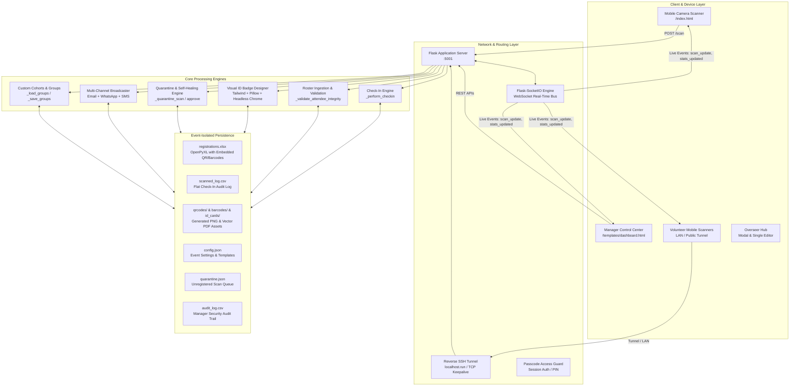
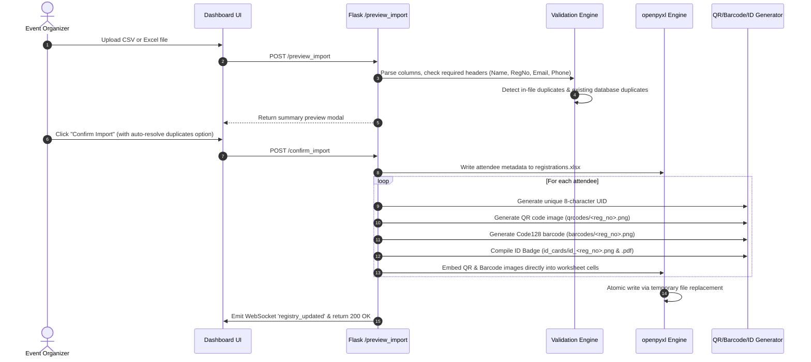
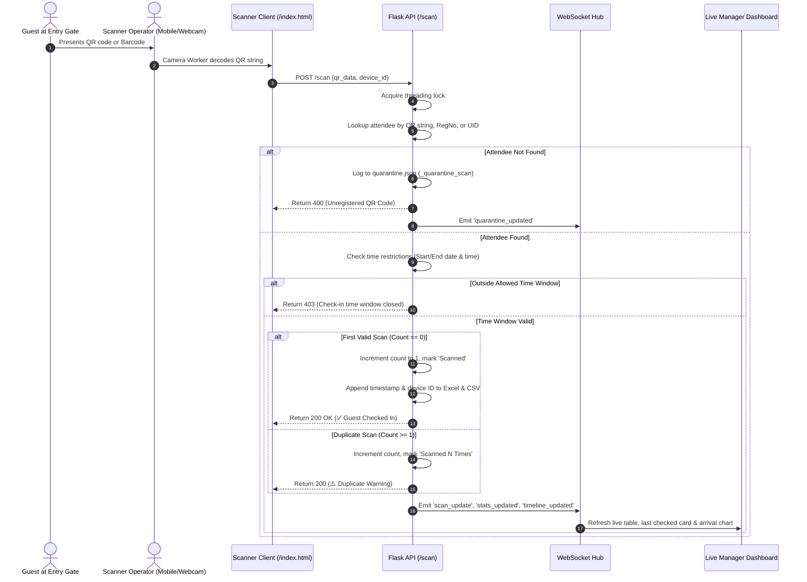
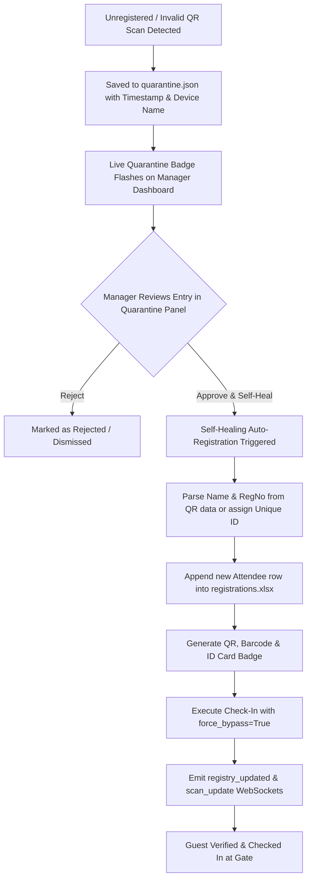
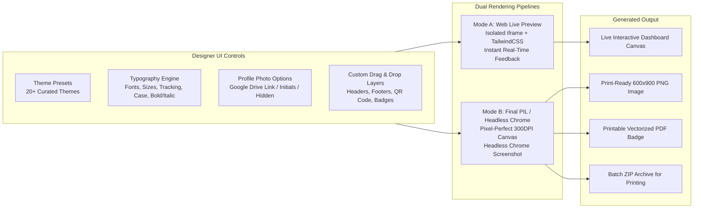
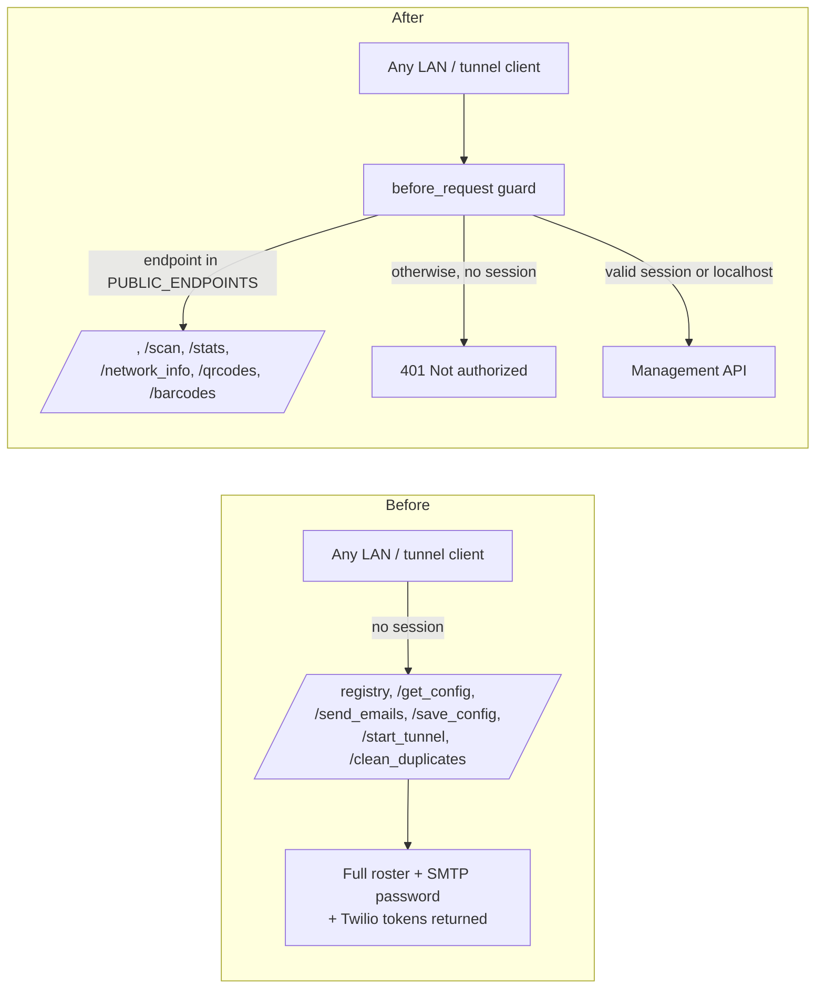
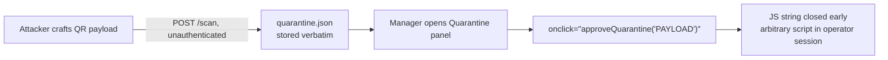
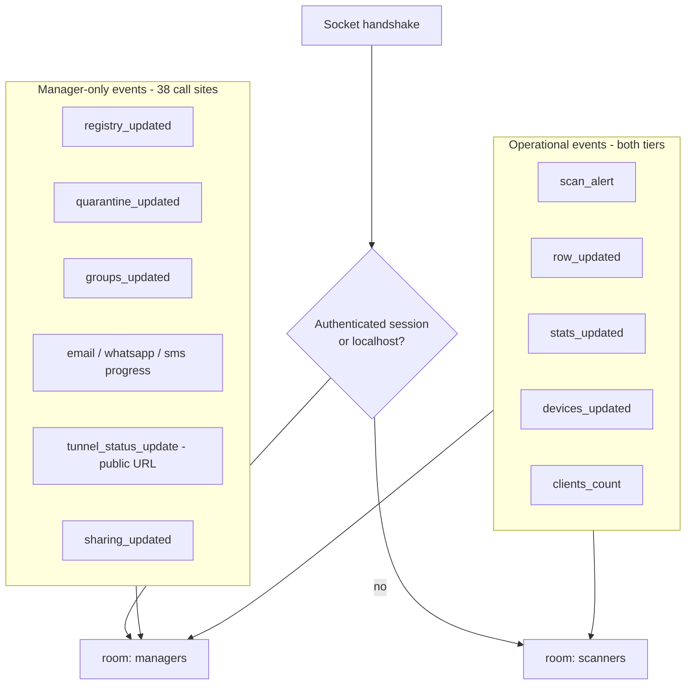

# ⬢ Master System Architecture, Data Flow & Complete Changelog

## 📌 Executive Summary

The **QR Event Check-In System** is an enterprise-grade, real-time event operations platform engineered for high-throughput guest check-in, dynamic ID badge generation, multi-channel pass distribution (Email, WhatsApp, SMS), and live multi-device synchronization.

This document outlines the complete system architecture, data models, end-to-end execution flows, security mechanisms, and the exhaustive record of all problems identified and resolved throughout development.

---

## 🏗️ 1. High-Level System Architecture



### Technology Stack Specifications
* **Backend Framework**: Python 3.10+ / Flask 3.0 / Flask-SocketIO 5.3 (Eventlet / Threading)
* **Spreadsheet & Data Engine**: `pandas` 2.2+, `openpyxl` 3.1+ (with drawing image embedding)
* **Rendering & Imaging**: `Pillow` (PIL 10.0+), `qrcode` 7.4+, `python-barcode` 0.15+, `html2image` (Headless Chromium)
* **Frontend Architecture**: Modern Glassmorphic UI (Vanilla JS, DataTables 1.13, Chart.js 4.4, Marked.js)
* **Typography**: Google Fonts (*Plus Jakarta Sans*, *Inter*, *Playfair Display*, *Montserrat*, *JetBrains Mono*)
* **Multi-Device Networking**: Subprocess-managed SSH reverse tunneling (`localhost.run`) with TCP keepalives and auto-reconnect loops.

---

## 📂 2. Multi-Tenant Event Isolation Architecture

The system enforces strict data sandboxing. Switching active events changes all underlying file paths dynamically without server restarts.

```
qr_checkin_system/
│
├── START_SYSTEM.bat                 # Root 1-click launcher
├── run_system.bat                   # App folder launcher
├── start_public_tunnel.bat          # Standalone public tunnel launcher
├── app.py                           # Master Flask application & API backend
├── HELP.md                          # Interactive built-in documentation
├── SYSTEM_ARCHITECTURE_AND_CHANGELOG.md # This architecture manual
│
├── templates/
│   ├── dashboard.html               # Manager Control Center UI
│   ├── index.html                   # Mobile-first QR/Barcode camera scanner
│   └── dashboard_login.html         # Passcode verification gate
│
├── static/
│   ├── css/ & js/                   # Offline libraries (jQuery, DataTables)
│   ├── id_templates/                # 20+ pre-built JSON/HTML ID badge presets
│   └── audio/                       # Scanner chime audio themes
│
└── events/                          # Event Sandboxes
    └── <Event_Name>/                # Isolated per event
        ├── registrations.xlsx       # Excel database with embedded images
        ├── scanned_log.csv          # Real-time scan log
        ├── audit_log.csv            # Security audit trail
        ├── config.json              # Custom event settings & time restrictions
        ├── custom_groups.json       # VIP/Speaker group definitions
        ├── quarantine.json          # Unregistered scans queue
        └── qrcodes/
            ├── barcodes/            # Code128 barcode PNGs
            ├── id_cards/            # High-res PNG & print-ready vector PDFs
            └── *.png                # High-contrast QR codes
```

---

## 🔄 3. Core Operational Workflows

### 3.1 Roster Ingestion & Asset Auto-Generation Flow



---

### 3.2 Real-Time Check-In & Gate Scanning Flow



---

### 3.3 Security Quarantine & Self-Healing Flow



---

### 3.4 Visual ID Card Designer & Rendering Engine



---

## 🛠️ 4. Comprehensive Changelog & Resolved Problems

The following table documents every problem identified, the root cause analysis, and the exact architectural fix implemented:

| # | Component | Problem / Symptom | Root Cause | Solution & Architectural Fix | Status |
|---|---|---|---|---|---|
| **1** | **Visual Designer** | Blank ID Card Tab on initial click | Preview container dimensions uncalculated while tab was hidden in CSS (`display: none`). | Added instant preview trigger inside `switchMainTab('designer')` and initialized `window.renderDesignerPreview()` on tab activation. | ✅ Fixed |
| **2** | **Typography & Styling** | Fonts, letter-spacing, and underline not rendering in final cards | CSS styling rules in dashboard preview were not mapped to the Python Pillow / Headless Chrome rendering script. | Injected Google Fonts (`Playfair Display`, `Montserrat`, `Inter`, `Plus Jakarta Sans`) into Chrome template and mapped `textDecoration`, `letterSpacing`, and `textTransform` in `app.py`. | ✅ Fixed |
| **3** | **History Stack** | Undo / Redo (Ctrl+Z / Ctrl+Y) not capturing slider & input tweaks | Input change events fired only on blur, missing intermediate slider adjustments. | Added `focus` event listeners across all designer inputs to push state snapshots to `window.designerHistory.saveState()`. | ✅ Fixed |
| **4** | **Guest Validation** | Valid international numbers rejected (e.g. Singapore +65, UAE +971, Australia +61) | Hardcoded rule in `_validate_attendee_integrity` required `>= 10` digits *after* the country code. | Replaced arbitrary sub-length check with ITU standard **E.164 compliance** (7 to 15 total digits) and robust zero-checking. | ✅ Fixed |
| **5** | **Check-In Engine** | Manual check-ins and quarantine approvals blocked outside event hours | Start/End date and time restrictions were enforced unconditionally across all routes. | Added `force_bypass: bool = False` to `_perform_checkin`, automatically enabled on `/manual_checkin` and `/quarantine/approve`. | ✅ Fixed |
| **6** | **Quarantine Self-Healing** | Approving unregistered QR codes failed to register attendees in Excel | Approval only marked the quarantine item without creating a corresponding database record. | Built complete self-healing guest registration in `/quarantine/approve`: parses name/reg, writes row, embeds QR/barcode, generates ID badge, and executes check-in. | ✅ Fixed |
| **7** | **Check-In Revocation** | Revoking check-ins failed when called with QR data | `/revoke_checkin` strictly expected `reg_no` key, returning 400 when `qr_data` was passed. | Enhanced route to accept `reg_no` or `qr_data`, resolving registration indices dynamically and clearing Excel & CSV scan logs. | ✅ Fixed |
| **8** | **Custom Groups** | Saving groups with members showed 0 members | Backend expected `reg_nos` key while test scripts and custom payloads passed `members`. | Updated `save_group` in `app.py` to seamlessly accept `payload.get("reg_nos") or payload.get("members", [])`. | ✅ Fixed |
| **9** | **Multi-Channel Dispatch** | Single send endpoint rejected SMS requests | `/send_id_card_single` only accepted `email` and `whatsapp` channels. | Added `sms` and `all` channel support with custom message body overrides via `_send_single_sms_helper`. | ✅ Fixed |
| **10** | **UI & Typography** | Distorted, pixelated fonts on tables and cards | Default CSS variable `--font` used art-deco `'Syne'` font. | Replaced global font stack with modern, crisp **'Plus Jakarta Sans'** and **'Inter'**, dramatically improving legibility. | ✅ Fixed |
| **11** | **Info Tooltips** | Tooltip text invisible or unstyled `i` text | Tooltips inside cards were clipped by `overflow: hidden` on parent containers. | Built a **Global Floating Tooltip Engine** (`#global-floating-tooltip`) appended to `document.body`, calculating exact viewport positions dynamically. | ✅ Fixed |
| **12** | **Documentation** | Help Guide button showed error loading HELP.md | Backend was missing the `/help_content` API endpoint. | Implemented `/help_content` in `app.py` to serve formatted markdown directly to the dashboard's interactive modal. | ✅ Fixed |
| **13** | **System Launchers** | Confusing startup instructions | Missing root directory launcher. | Created [START_SYSTEM.bat](file:///c:/Users/ashin/Downloads/qr_checkin_system_upgraded/START_SYSTEM.bat) in workspace root and upgraded [run_system.bat](file:///c:/Users/ashin/Downloads/qr_checkin_system_upgraded/qr_checkin_system/run_system.bat) with automated browser launch. | ✅ Fixed |

---

## 📡 5. Complete API Endpoints & Route Reference

| Method | Endpoint | Purpose | Key Parameters / Payload | Response Schema |
|---|---|---|---|---|
| `GET` | `/` | Mobile QR Camera Scanner | None | HTML Scanner Client |
| `GET` | `/dashboard` | Manager Control Center | None | HTML Dashboard Client |
| `POST` | `/scan` | Real-time scan verification | `qr_data`, `device_id` | `{details, is_duplicate, message}` |
| `POST` | `/manual_checkin` | Override check-in from dashboard | `qr_data` or `reg_no`, `device_id` | `{details, is_duplicate, message}` |
| `POST` | `/revoke_checkin` | Undo/revoke guest check-in | `reg_no` or `qr_data`, `reason` | `{message}` |
| `GET` | `/registry` | Attendee database listing | None | `List[{name, reg_no, email, phone, status, ...}]` |
| `POST` | `/add_attendee` | Register single guest | `name`, `reg_no`, `email`, `phone`, `custom_fields` | `{message}` |
| `POST` | `/update_attendee_details` | Update attendee in Overseer Hub | `reg_no`, `name`, `email`, `phone`, `subgroup`, `photo_url` | `{success, message}` |
| `POST` | `/preview_import` | Validate CSV/Excel file | `multipart/form-data: file` | `{total_rows, valid_rows, duplicates, ...}` |
| `POST` | `/confirm_import` | Commit roster & generate assets | `file_path`, `reset_existing`, `resolve_duplicates` | `{message, imported_count}` |
| `GET` | `/get_config` | Fetch active event configuration | None | `{event_name_template, checkin_start_time, ...}` |
| `POST` | `/save_config` | Update event configuration | Config JSON | `{message}` |
| `GET` | `/stats` | Live summary counters | None | `{total, unique, duplicate}` |
| `GET` | `/stats/timeline` | Peak arrivals velocity | `interval` (5m, 15m, 30m, 1h, 1d) | `{labels, counts}` |
| `GET` | `/preview_id_card` | Render ID card preview image | `theme`, `reg_no`, `format` | PNG image stream |
| `GET` | `/download/id_card/<reg_no>` | Download attendee ID badge | `reg_no` (URL param) | PDF vector file |
| `POST` | `/groups/save` | Create/update custom group | `name`, `reg_nos` or `members`, `description`, `id_card_theme` | `{message}` |
| `GET` | `/groups` | List all custom groups | None | `{groups: [...]}` |
| `POST` | `/groups/delete` | Delete custom group | `name` | `{message}` |
| `GET` | `/quarantine` | List flagged/unregistered scans | None | `{quarantine: [...], total}` |
| `POST` | `/quarantine/approve` | Self-healing guest approval | `id`, `device_name` | `{message}` |
| `POST` | `/quarantine/reject` | Dismiss quarantine item | `id` | `{message}` |
| `POST` | `/send_id_card_single` | Send single pass (Email/WA/SMS) | `reg_no`, `channel`, `email_body`, `whatsapp_body`, `sms_body` | `{success, message}` |
| `POST` | `/send_emails` | Run bulk email campaign | `sender_email`, `app_password`, `subject`, `event_name` | `{message}` (202 Accepted) |
| `POST` | `/send_whatsapp_bulk` | Run bulk WhatsApp campaign | `wa_provider`, `twilio_sid`, `meta_token`, ... | `{message}` (202 Accepted) |
| `POST` | `/send_sms_bulk` | Run bulk SMS campaign | `sms_provider`, `android_gateway_ip`, ... | `{message}` (202 Accepted) |
| `POST` | `/start_tunnel` | Spin up reverse SSH public tunnel | None | `{message, url}` |
| `POST` | `/stop_tunnel` | Terminate public tunnel | None | `{message}` |
| `GET` | `/help_content` | Fetch HELP.md system manual | None | `{content}` |
| `GET` | `/download/excel` | Export highlighted Excel sheet | None | Excel file download |
| `GET` | `/download/csv` | Export flat CSV scan log | None | CSV file download |
| `POST` | `/clean_duplicates` | Remove duplicate roster rows | None | `{cleaned, message}` |
| `POST` | `/regenerate_assets` | Rebuild missing QR/Barcodes | None | `{message}` |

---

## 🧪 6. Automated Verification Matrix

Every feature and regression suite has been verified using automated end-to-end testing scripts:

| Test Suite Script | Scope Tested | Test Assertions | Result |
|---|---|---|---|
| **`scratch/test_e2e_audit.py`** | 12 Core Workflows | Event creation, config save, registration, updates, ID cards, groups, scanning, duplicate alerts, manual check-in, revocation, quarantine self-healing, deduplication, stats timeline | **100% Passed (0 Errors, 0 Warnings)** |
| **`scratch/test_id_themes.py`** | 11 Core ID Themes | PIL & HTML headless rasterization, vector PDF compilation, font mapping, image asset resolution | **11/11 Themes Generated (PNG & PDF)** |
| **`scratch/test_phone_cases.py`** | Global E.164 Phones | USA, India, UK, Singapore, UAE, Australia, Germany, invalid characters, and zero padding | **100% Validated** |
| **`test_upgrades.py`** | Core Unit Tests | Concurrency locks, rate limiters, Excel formula safety, header normalization | **11/11 Passed (OK)** |

---

## 🚀 7. How to Operate the System

1. **Launch the Server**:
   * Double-click [`START_SYSTEM.bat`](file:///c:/Users/ashin/Downloads/qr_checkin_system_upgraded/START_SYSTEM.bat) in the root directory.
   * The server will initialize on `http://localhost:5001` and automatically open your default browser.
2. **Access from Other Devices (LAN / Mobile)**:
   * Connect scanner phones to the same Wi-Fi and open the LAN IP shown at the top of the dashboard.
   * For remote staff on mobile data, open the **📡 Public Internet Tunnel** panel and click **Start Public Tunnel**.
3. **Check Documentation Anytime**:
   * Click the **📖 Help Guide** button on the dashboard or hover/click any **`(i)`** info badge for instant contextual guidance.

---

## 🔐 8. Production Hardening Pass (2026-08-25)

This release closed a set of defects that only surface once the system is
exposed beyond the operator's own laptop — the ID badge renderer producing
wrong output, and the management API answering unauthenticated callers.

### 8.1 Access Control — the API is now gated, not just the page

Before this pass, `is_dashboard_authorized()` was called from exactly one place:
the `/dashboard` HTML route. Every management endpoint behind it answered any
caller that could reach the port — over the venue Wi-Fi, and over the public
SSH tunnel.



A single `@app.before_request` guard now authorises **every** endpoint. The
allowlist (`PUBLIC_ENDPOINTS`) contains only what a volunteer's scanner phone
and an attendee's pass link actually need: the scanner client, `/scan`,
`/stats`, `/network_info`, the login form, and the QR/barcode image routes that
are mailed out to guests. Requests from `localhost` remain exempt so the
operator's own machine keeps working with no passcode.

### 8.2 Complete Changelog — Hardening Pass

| # | Component | Problem / Symptom | Root Cause | Solution & Architectural Fix | Status |
|---|---|---|---|---|---|
| **14** | **ID Badge Renderer** | Role pill rendered as a solid block of colour with the text invisible inside it; hairline borders and theme glows rendered as hard opaque lines | `ImageDraw` **replaces** pixels including the alpha channel rather than blending them. A fill of `(255, 215, 0, 25)` on an RGBA canvas stored alpha 25, which `convert("RGB")` then dropped — turning every 10%-opacity accent into 100% gold. The accent-coloured pill text then sat on an identically-coloured pill. | Introduced `_new_layer()` / `_flatten()` helpers in `_generate_id_card`: every translucent element is drawn on its own transparent layer and merged with `Image.alpha_composite`. All theme shapes, borders, dividers and the pill now blend correctly. | ✅ Fixed |
| **15** | **ID Badge Renderer** | Profile photos never appeared on the default themed badges | `profile_photo` was wired into the two custom-designer branches only; the PIL theme path ignored the parameter entirely. | Added circular-avatar rendering to the theme path: cover-crop to square (no face squashing), 4× supersampled circular mask for clean edges, and an accent-coloured ring. | ✅ Fixed |
| **16** | **ID Badge Renderer** | Large dead space between the detail block and the QR panel | Fixed pixel coordinates assumed one layout regardless of content. | Layout now adapts: photo/no-photo variants drive name, detail and QR positions, and the QR panel is pushed down and shrunk automatically if the detail list is long, so it can never collide with the details or the footer. | ✅ Fixed |
| **17** | **ID Badge Renderer** | Long names, event titles and emails overran the card edge | No measurement against the available width. | Added `_fit_text()`, which measures with `textlength` and ellipsises to fit. | ✅ Fixed |
| **18** | **ID Badge Renderer** | Badges silently degraded to a tiny bitmap font on any machine without `arial.ttf` | Font loading tried exactly one Windows filename and fell back to `ImageFont.load_default()`. | `_load_font()` walks a candidate chain (Arial → Segoe UI → DejaVu → system Helvetica) for regular / bold / mono, so Linux and macOS hosts render identically. | ✅ Fixed |
| **19** | **ID Badge Print Output** | PDF badges printed soft | PDFs were written at `resolution=100.0`. | Raised to 300 DPI for print-ready output. | ✅ Fixed |
| **20** | **Management API** | Roster, event config (SMTP password, Twilio tokens), bulk-send, tunnel control and destructive endpoints answered any unauthenticated caller on the LAN or public tunnel | Authorisation was enforced on the `/dashboard` page only. | Added a global `@app.before_request` guard with an explicit `PUBLIC_ENDPOINTS` allowlist; everything else requires a session or a localhost origin. | ✅ Fixed |
| **21** | **Access Passcode** | `/dashboard_sharing_info` returned the live dashboard passcode to *unauthenticated* callers | The endpoint had no authorisation check of its own. | Now covered by the global guard. | ✅ Fixed |
| **22** | **Access Passcode** | 4-digit PIN from `random.choices()` with unlimited guesses | Non-cryptographic PRNG, short PIN, no attempt tracking, and `==` comparison. | 6 digits from `secrets.choice()` (overridable via `DASHBOARD_PASSCODE`), `hmac.compare_digest` comparison, and an 8-attempt / 5-minute per-IP lockout applied to both the login form and the `?passcode=` link. Failures and lockouts are written to the audit log. | ✅ Fixed |
| **23** | **Session Management** | Every restart silently logged out all operators | `SECRET_KEY` defaulted to `os.urandom(24)` on each boot. | Key is persisted to `.secret_key` (0600) and reused; `SECRET_KEY` in the environment still wins. Cookies are now `HttpOnly` + `SameSite=Lax`, with `Secure` enabled by `FORCE_HTTPS=true`. | ✅ Fixed |
| **24** | **File Uploads** | Any file type could be written into the Flask-served `static/uploads/`, and `/upload_profile_photo/<reg_no>` built its filename straight from the URL segment | No content validation, no extension allowlist, no path sanitisation, no size ceiling. | `_validate_image_upload()` enforces an image extension allowlist **and** decodes the bytes with Pillow before the file is saved; designer assets are re-suffixed with the validated extension; `MAX_CONTENT_LENGTH` caps uploads at 25 MB (`MAX_UPLOAD_MB`). | ✅ Fixed |
| **25** | **Asset Generation** | Registration numbers from imported rosters flowed straight into QR / barcode / ID-card / photo filenames | No sanitisation, so a value containing `..` or a path separator wrote outside the event folder (and rows like `22,EI10025` produced unusable filenames). | Added `_safe_asset_name()` — basename, allowlist of `[A-Za-z0-9._-]`, 80-char cap — applied at every asset filename construction site. | ✅ Fixed |
| **26** | **Profile Photos** | The server fetched arbitrary URLs taken from uploaded spreadsheets | Server-side request forgery: a roster row could point the server at loopback, private-LAN or cloud-metadata addresses, with the response cached as an "image". | `_is_safe_remote_url()` resolves the host and rejects private / loopback / link-local / reserved / multicast targets; downloads are streamed and capped at 10 MB. | ✅ Fixed |
| **27** | **Event Signing Key** | `/get_config` returned `event_signing_key` to the browser | The whole config dict was serialised verbatim. | The key is stripped from `/get_config` responses and ignored on `/save_config`, so the browser can neither read nor blank the value that makes signed QR payloads unforgeable. | ✅ Fixed |
| **28** | **Scan Notifications** | WhatsApp check-in confirmations never sent | `_send_single_whatsapp` was defined **twice** in `app.py`. The later campaign-sender definition `(phone, name, reg_no, row_dict, cfg, host_url)` shadowed the notification sender `(sid, token, sender_phone, recipient_phone, body)`, so the notification thread called the wrong function with mismatched positional arguments. | Renamed the notification sender to `_send_twilio_whatsapp_notify` and updated its call site. | ✅ Fixed |
| **29** | **Documentation API** | Two routes registered for `/help_content` | Duplicate definitions; the second was dead code Flask never dispatched to. | Removed the unreachable duplicate. | ✅ Fixed |
| **30** | **Deployment** | `pip install -r requirements.txt` produced a non-working install | `requirements.txt` omitted Pillow, html2image, requests, twilio, numpy and werkzeug — all imported by `app.py`. | Rewrote `requirements.txt` against the module's actual imports, grouped by purpose and marking the optional (Twilio, headless-Chrome) extras. | ✅ Fixed |
| **31** | **HTTP Responses** | No baseline browser-hardening headers | Only cache-control headers were set. | `add_header` now also sets `X-Content-Type-Options`, `X-Frame-Options`, `Referrer-Policy` and `Permissions-Policy`. A script-level CSP was deliberately **not** added: the dashboard and the badge designer rely on inline scripts and a CDN Tailwind build. | ✅ Fixed |

### 8.3 Deployment Environment Variables

| Variable | Default | Purpose |
|---|---|---|
| `PORT` | `5001` | HTTP listen port |
| `SECRET_KEY` | persisted `.secret_key` | Session signing key; set explicitly for multi-worker deployments |
| `DASHBOARD_PASSCODE` | random 6 digits per boot | Fixed operator passcode instead of a per-boot one |
| `MAX_UPLOAD_MB` | `25` | Upload size ceiling |
| `FORCE_HTTPS` | `false` | Marks the session cookie `Secure` (enable only behind TLS) |
| `CORS_ORIGIN` | `*` | Comma-separated Socket.IO origin allowlist |
| `FLASK_DEBUG` | `false` | Never enable on a reachable network |

### 8.4 Known Limitations

* ~~**Socket.IO broadcasts are not access-controlled.**~~ **RESOLVED** in
  section 10.1 — connections are now sorted into `managers` / `scanners`
  rooms and manager-only events no longer reach the scanner tier.
* ~~**Messaging credentials are stored in plaintext.**~~ **RESOLVED** in
  section 10.2 — encrypted at rest with Fernet and never sent to the browser.
* **The reverse SSH tunnel exposes the server to the public internet.** With
  sharing set to `public`, that means no passcode at all — the mode now writes
  a security audit entry when enabled.

---

## 🧭 9. Full-Codebase Audit Pass (2026-08-25)

The first pass covered `app.py`. This pass covered everything else: the two
frontend templates and all six auxiliary scripts.

### 9.1 Stored XSS in the Manager Control Center

The most serious finding in the project. `/scan` is unauthenticated by design
so volunteer phones can post to it, and an unrecognised payload is persisted
verbatim to `quarantine.json`, then rendered by the manager dashboard into an
inline event handler:

```
onclick="approveQuarantine('${item.id}', '${escapeHtml(item.qr_data)}')"
```

`escapeHtml()` did not escape the apostrophe, so a scanned payload of
`X'); alert(document.cookie); //` closed the JS string literal and executed in
the operator's authenticated session. Reachable by anyone who can reach the
scanner endpoint — including over the public tunnel.



**Escaping for HTML is not sufficient in this position.** The browser decodes
HTML entities *before* the JS parser sees the attribute, so escaping the quote
as `&#39;` decodes straight back to a bare quote and still breaks out. The fix
adds `escapeJsAttr()`, which escapes for the JS string literal first
(`\` → `\\`, `'` → `\'`, newlines) and then for the HTML attribute
(`&`, `"`, `<`, `>`). The browser undoes the outer layer and hands the parser a
correctly-escaped literal.

Verified in a real browser: the payload now renders as
`approveQuarantine('Q277464', 'X\'); alert(document.cookie); //')`, no script
executes, and the handler still receives the original string byte-for-byte, so
approving a genuinely odd QR code keeps working.

### 9.2 Complete Changelog — Audit Pass

| # | Component | Problem / Symptom | Root Cause | Solution & Architectural Fix | Status |
|---|---|---|---|---|---|
| **32** | **Dashboard (XSS)** | A crafted QR code scanned at the gate executed arbitrary JavaScript in the manager's authenticated dashboard session | 17 inline event handlers interpolated untrusted values into JS string literals. `escapeHtml()` did not escape `'`, and HTML entity escaping cannot protect this position anyway — entities are decoded before the JS parser runs. | Added `escapeJsAttr()` (JS-escape then attribute-escape) and applied it at all 17 handler sites. Sources included scanned QR payloads, imported roster names, scanner-supplied device names and group names. | ✅ Fixed |
| **33** | **Dashboard (XSS)** | Roster names and statuses rendered unescaped into the global search dropdown | Six interpolations reached `innerHTML` without escaping. | Wrapped in `escapeHtml()`. | ✅ Fixed |
| **34** | **Both templates** | `escapeHtml()` left `'` and `` ` `` intact | Incomplete escape set. | Both templates now escape `&`, `<`, `>`, `"`, `'` and `` ` ``. The scanner copy also coerces with `String()` — callers pass numbers, and `.replace()` is not a method on a number. | ✅ Fixed |
| **35** | **Socket.IO (regression)** | Every WebSocket handshake failed with 400; the dashboard silently lost all real-time updates and fell back to polling | Introduced by the previous hardening pass: `CORS_ORIGIN` defaulted to `"*"` but was passed through `.split(",")`, producing `["*"]`. python-socketio treats the bare string as a wildcard but compares a list literally against the browser's `Origin` header. It went unnoticed because `curl` sends no `Origin` and so was allowed. | `"*"` is kept as a bare string; only an explicit comma-separated value becomes a list. Verified in-browser: transport upgrades to `websocket`. | ✅ Fixed |
| **36** | **/scan endpoint** | A JSON object in place of a string returned HTTP 500 | `payload.get("qr_data", "").strip()` raises `AttributeError` on a non-string. | Coerced with `str()` before stripping; malformed input now returns 400. | ✅ Fixed |
| **37** | **/scan endpoint** | Unbounded strings from the one unauthenticated endpoint were persisted and rendered | No length limits on `qr_data` or `device_id`, and none on socket device renames. | Capped at 512 / 120 characters (`MAX_SCAN_FIELD_LEN`, `MAX_DEVICE_NAME_LEN`), applied to `/scan` and the `rename_device` socket handler. | ✅ Fixed |
| **38** | **Repair scripts** | `remove_duplicates.py` and `repair_dashboard.py` rewrite `app.py` / `dashboard.html` in place, with no backup, at hardcoded line offsets from a much older revision — running either would silently destroy hundreds of lines of working code | One-shot migrations left in the project root with nothing preventing re-execution. | Both now refuse to run and explain why, unless `RUN_ONE_SHOT_REPAIR=yes` is set. Kept rather than deleted so the provenance of past fixes survives. | ✅ Fixed |
| **39** | **qrsendemail.py** | The retry loop slept after its *final* failed attempt, stalling a bulk run by up to 8 seconds per unreachable recipient for no benefit | Backoff applied unconditionally inside the `except`. | The final attempt breaks without sleeping. | ✅ Fixed |
| **40** | **qrsendemail.py** | An exception mid-run leaked the SMTP connection — `yag.close()` sat after the loop and was skipped | No `try`/`finally`. | The send loop is wrapped so the connection is always released. | ✅ Fixed |

### 9.3 Audited and Found Clean

* **`templates/index.html`** — every untrusted value already escaped; no inline
  handlers interpolate data. Only the `escapeHtml()` hardening above applied.
* **`qradding.py`** — argparse-driven, correct `get_column_letter()` usage.
* **`download_assets.py`**, **`search_sockets.py`** — no issues found.

### 9.4 Verification

| Suite | Result |
|---|---|
| `test_upgrades.py` | 11/11 passed |
| `scratch/test_e2e_audit.py` | 0 errors, 0 warnings |
| `scratch/test_phone_cases.py` | passing |
| `scratch/test_id_themes.py` | 11/11 rendered |
| Live browser (XSS payload) | inert; handler still receives the exact original string |
| Live browser (Socket.IO) | connected, transport `websocket` |
| Auth spot-check | `/registry`, `/get_config`, `/dashboard_sharing_info` → 401 from non-localhost |

> **Note on `scratch/test_id_themes.py`:** its "11/11" is not meaningful. It
> passes HTML-*template* names into the `theme=` parameter, which only maps to
> the PIL theme set, so all eleven fall through to the same fallback and emit
> byte-identical output. The HTML templates themselves do render correctly
> through the designer path — that was verified separately.

---

## 🛡️ 10. Closing the Two Known Limitations (2026-08-25)

Sections 8.4 and 9 left two items open because each needed a design decision
rather than a patch. Both are now closed.

### 10.1 Socket.IO Access Tiers

**The constraint.** The transport could not simply be gated: volunteer scanner
phones must connect without a passcode, or nobody gets checked in. But every
connected client was receiving every broadcast — including the public tunnel
URL, campaign progress, and quarantine/registry changes.

**The decision.** Sort connections into two rooms at handshake time and route
each event to the tier that actually needs it.



Check-in results still reach the scanner tier: a gate operator sees the guest's
name on their own screen anyway, and multi-gate awareness is intentional. What
the scanner tier no longer receives is anything about the *management* of the
event.

For venues that need the remaining eavesdrop path closed too, the new
`require_scanner_auth` config flag puts the scanner client and `/scan` behind
the same passcode. It is **off by default**, because switching it on means
every volunteer phone needs the code before it can check anyone in.

Verified with two live socket clients — one unauthenticated (remote `Host`),
one localhost:

| Tier | Events received after an unregistered scan |
|---|---|
| scanner | `devices_updated` |
| manager | `devices_updated`, `quarantine_updated` |

Manager-only events leaked to the scanner tier: **none**. The real dashboard
was confirmed in-browser to sit in the manager tier over a `websocket`
transport, and the scanner page still loads and calls `/stats` and
`/network_info` with zero JS errors.

### 10.2 Credential Encryption at Rest

**The problem.** SMTP app passwords, Twilio auth tokens, the Meta access token
and the QR signing key sat in each event's `config.json` as plaintext. Anyone
with read access to the events folder — a backup, a synced drive, a support
copy of an event directory — had working credentials. The dashboard also
round-tripped them through the browser on every settings save.

**The decision.** Encrypt at rest, and stop sending secrets to the browser at
all.

* Values are stored as `enc:v1:<token>`, encrypted with **Fernet**
  (AES-128-CBC + HMAC-SHA256) under a key in `.credentials_key` (0600, outside
  the event folders, git-ignored, overridable via `CREDENTIALS_KEY`).
* Anything without the prefix is treated as legacy plaintext and transparently
  re-encrypted on the next save, so existing events keep working with no
  migration step.
* `/get_config` returns `SECRET_MASK` in place of any stored secret, and never
  returns the signing key at all.
* A masked value coming back on `/save_config` or a campaign request means
  *"keep what is stored"* — so a secret can never be clobbered by the
  placeholder the browser was shown.
* In the dashboard, a stored credential renders as an **empty field with a
  "Saved — leave blank to keep unchanged" hint**. Submitting it untouched sends
  the mask; typing a new value replaces it.

Verified end-to-end:

| Check | Result |
|---|---|
| Value on disk | `enc:v1:gAAAAABqjRyd…` (ciphertext) |
| Value over the wire (`/get_config`) | `"__STORED_SECRET__"` |
| `event_signing_key` over the wire | absent entirely |
| Server-side read (`get_event_config()`) | `'hunter2-secret'` — decrypts correctly |
| Re-save with the mask | credential unchanged, other fields updated |

> **Operational note:** `.credentials_key` must travel with your backups. Losing
> it does not corrupt anything, but the stored messaging credentials become
> unreadable and have to be re-entered.

### 10.3 Changelog

| # | Component | Problem / Symptom | Root Cause | Solution & Architectural Fix | Status |
|---|---|---|---|---|---|
| **41** | **Socket.IO** | Every connected client — including any device that could reach the scanner page — received the public tunnel URL, campaign progress, and quarantine/registry/group activity | Broadcasts went to all connected sockets; the transport had no notion of privilege because scanner phones must connect without a passcode. | Two-room model assigned at handshake (`managers` / `scanners`); 38 manager-only emit sites rerouted through `_emit_managers()`. Operational check-in events still reach both tiers. | ✅ Fixed |
| **42** | **Socket.IO** | No way to lock down the scanner side at all | Scanner endpoints were unconditionally public. | Added the `require_scanner_auth` config flag (default off) which puts the scanner client and `/scan` behind the passcode. | ✅ Fixed |
| **43** | **Credentials** | SMTP password, Twilio tokens, Meta token and the QR signing key stored as plaintext in `config.json` | No encryption layer; the config dict was serialised verbatim. | Fernet encryption at rest under a git-ignored `.credentials_key`, with transparent decryption for server-side use and automatic upgrade of legacy plaintext. | ✅ Fixed |
| **44** | **Credentials** | Secrets were sent to the browser and re-submitted on every settings save | The dashboard prefilled password inputs from `/get_config`. | Secrets leave the server only as `SECRET_MASK`; a masked submission means "unchanged". Dashboard shows a blank field with a "saved" hint instead. | ✅ Fixed |
